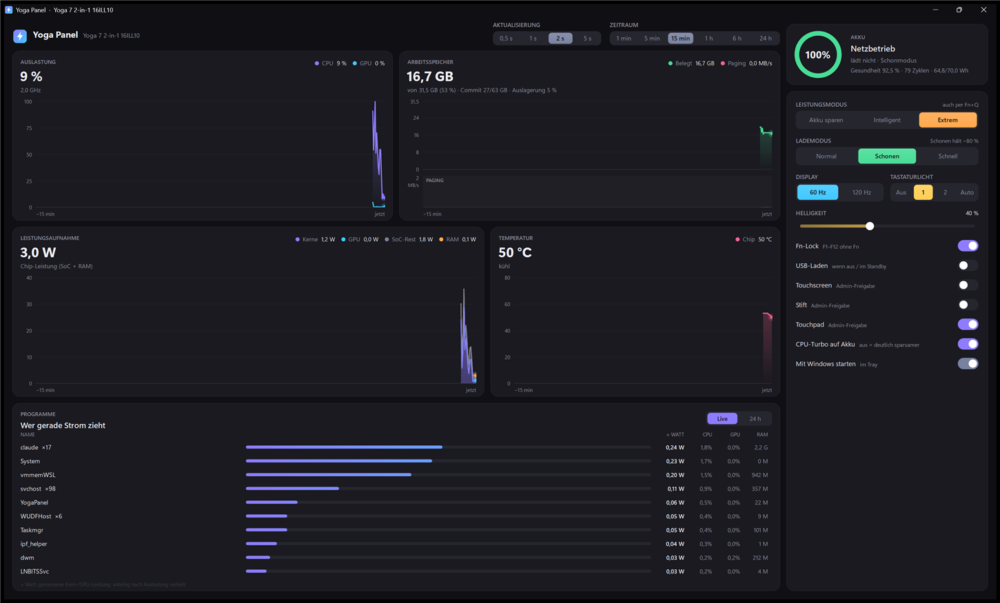

# Yoga Panel

Schlanke Steuerzentrale für das **Lenovo Yoga 7 2-in-1 16ILL10** (Intel Lunar Lake). Ersetzt Lenovo Vantage und das Legion Toolkit: zwei kleine EXE-Dateien (~340 KB), kein Hintergrunddienst, kein Konto.

**[Übersicht](https://jsplice.github.io/yoga-panel/) · [Dokumentation](https://jsplice.github.io/yoga-panel/doku.html) · [Download](https://github.com/Jsplice/yoga-panel/releases/latest/download/YogaPanel.zip)**



## Funktionen

- **Live-Diagramme**: Leistung gestapelt nach Kernen, GPU, SoC und RAM, Auslastung, Arbeitsspeicher mit Paging, Temperatur. Aktualisierung 0,5–5 s, Zeitraum 1 min bis 24 h, Verlauf 48 h gespeichert.
- **Leistungsmodus** Akku sparen / Intelligent / Extrem (wie <kbd>Fn</kbd>+<kbd>Q</kbd>) samt passendem Windows-Energiemodus, CPU-Turbo, max. Prozessorleistung.
- **Lademodus** Normal / Schonen (~80 %) / Schnell, Akku-Gesundheit und Zyklen.
- **Yoga-Hardware**: Touchscreen, Stift und Touchpad abschalten, Fn-Lock, USB-Laden im Standby, Tastaturlicht, 60/120 Hz, Helligkeit.
- **Programmliste**: wer gerade Strom zieht (live) oder der Windows-Energieverbrauch pro App der letzten 24 h.
- **Tray-Symbol** mit aktueller Leistung in Watt, Rechtsklick für Modus und Lademodus. Versteckt etwa 0,2 % eines CPU-Kerns.

## Installation

1. [YogaPanel.zip](https://github.com/Jsplice/yoga-panel/releases/latest/download/YogaPanel.zip) herunterladen und entpacken. `YogaPanel.exe` und `yoga.exe` müssen im selben Ordner liegen.
2. `YogaPanel.exe` starten.

Voraussetzung ist nur das .NET Framework 4.8, das in Windows 10/11 enthalten ist. Die Programme sind nicht signiert, SmartScreen fragt daher beim ersten Start nach („Weitere Informationen“ → „Trotzdem ausführen“).

## Kommandozeile

| Befehl | Wirkung |
|---|---|
| `yoga` | Alles auf einen Blick |
| `yoga live [sek]` | Live-Monitor mit Hotkeys (1/2/3 Modus, c Laden, h Hz, k Licht, f Fn, t Touch, s Sortierung, q Ende) |
| `yoga top [n]` | Programme nach CPU, GPU, RAM und ≈ Watt |
| `yoga apps [stunden] [--akku]` | Energie pro App laut Windows-Energieschätzung (Admin/UAC) |
| `yoga akku [--report]` | Akku-Gesundheit, Zyklen, Spannung; `--report` öffnet den Windows-Akkubericht |
| `yoga modus spar\|auto\|max` | Lenovo-Leistungsmodus und passender Windows-Energiemodus. `--nur-lenovo` lässt Windows unverändert |
| `yoga winmodus effizienz\|ausgeglichen\|leistung` | Nur den Windows-Energiemodus |
| `yoga laden normal\|schonen\|schnell` | Lademodus (schonen = Erhaltungsmodus ~80 %) |
| `yoga boost an\|aus\|effizient [--ac\|--dc]` | CPU-Turbo |
| `yoga cpumax 5-100 [--ac\|--dc]` | Max. Prozessorleistung |
| `yoga plan [name\|nr]` | Windows-Energiepläne |
| `yoga touch\|stift\|touchpad an\|aus` | Eingabegeräte (Admin/UAC) |
| `yoga fnlock an\|aus` | Fn-Lock |
| `yoga tastatur aus\|niedrig\|hoch\|auto` | Tastaturbeleuchtung |
| `yoga usb an\|aus` | USB-Laden im ausgeschalteten Zustand oder im Standby |
| `yoga hz [60\|120\|min\|max]` | Bildwiederholrate des internen Displays |
| `yoga hell [0-100]` | Helligkeit |

## Selbst bauen

```bat
git clone https://github.com/Jsplice/yoga-panel.git
cd yoga-panel
build.cmd
```

`build.cmd` nutzt den C#-Compiler, der mit dem .NET Framework in Windows mitkommt. Es muss nichts installiert werden.

## Technik

Alle Lenovo-Funktionen laufen über den Lenovo-Treiber `\\.\EnergyDrv` (AcpiVpc.sys) und brauchen keine Admin-Rechte. Auf dem 16ILL10 verifiziert:

| IOCTL | ACPI | Nutzung |
|---|---|---|
| `0x8310213C` | DYTC | Leistungsmodus: GET = 2; SET sparen `0x13B001`, max `0x12B001`, Standard `0x1FB001` |
| `0x831020F8` | GBMD/SBMC | Lademodus: 0xFF lesen (Bit 5 = schonen, Bit 2 = schnell); 3/5 schonen an/aus, 7/8 schnell an/aus |
| `0x831020E8` | HALS/SALS | 2 lesen (Bit 10 = Fn-Lock, Bit 7 = USB-Laden); 0x0E/0x0F Fn-Lock an/aus, 0x0A/0x0B USB an/aus |
| `0x83102144` | KBLC | 1 = Typ abfragen; 2\|Typ<<4 = lesen; 3\|Typ<<4\|Stufe<<16 = setzen |

Die Legion-Schnittstellen (`LENOVO_GAMEZONE_DATA` & Co.) gibt es zwar, die Firmware des Yoga implementiert sie aber nicht. Deshalb funktioniert das Legion Toolkit hier schlecht.

Messwerte: Intel RAPL über die Leistungszähler „Energy Meter“ (Watt für SoC, Kerne, GPU und RAM), PDH mit englischen Zählernamen (unabhängig von der Systemsprache), Prozesse über `NtQuerySystemInformation`, App-Energie über `powercfg /srumutil`. Mehr in der [Dokumentation](https://jsplice.github.io/yoga-panel/doku.html#technik).

## Lizenz

[MIT](LICENSE). Kein offizielles Lenovo-Produkt; Nutzung auf eigene Verantwortung.
